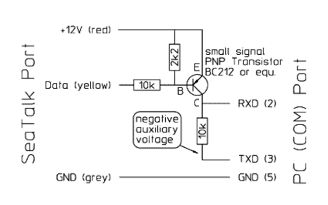
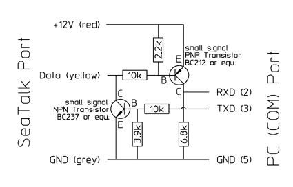

# Thomas Knauf: SeaTalk Technical Reference

> Converted from `Thomas_Knauf_SeaTalk_Technical_Reference-2.pdf`, a 2019 print of
> <http://www.thomasknauf.de/seatalk.htm> (Revision 3.23, July 2017). Page headers and
> navigation links were removed. Datagram tables and code are kept preformatted.
> Circuit images are in `knauf-img/`.

## Overview

*Stand: 29.07.2017*

## General Information

SeaTalk is a simple interface for networking Raymarine/Autohelm marine equipment so that all devices of a ship can exchange and share their data. SeaTalk is a proprietary solution of Autohelm and not compatible with NMEA or CAN. Unfortunately Raymarine keeps the technical details of SeaTalk secret. To assist users who want to develop hard- or software to connect their devices to the SeaTalk bus these pages uncover some of the mysteries. Part 3 adds hints how to interface SeaTalk with a PC. The information is unsupported by Raymarine and was found by watching the bits travelling on the bus. Therefore the description is incomplete inaccurate and may even be wrong. Corrections and contributions are welcome.

## Content

The technical description of the SeaTalk protocol is divided into three parts:

1. Part 1: How SeaTalk works
    - a. Hardware-Interface describes the function of the three SeaTalk wires
    - b. Serial Data Transmission describes the parameters of the asynchron serial port
    - c. Composition of Messages describes the structure of datagrams
    - d. Collision Management describes the arbitration between simultaneous talkers
    - e. Data Coding describes common rules for coding numerical values
2. Part 2: Recognized Datagrams describes the SeaTalk messages and their meaning
3. Part 3: Processing SeaTalk Data with a PC
    - a. Circuit example for an unidirectional SeaTalk => PC interface
    - b. Circuit example for a bidrectonal SeaTalk <=> PC interface
    - c. Simple SeaTalk monitoring utility for download
    - d. SeaTrack: VisualBasic software for trip documentation
    - e. SeaSigma: A small SeaTalk command generator for download

## Revision History

- Rev 3.23: [July 2017] Commands 85 and 89 corrected thx Mindert Sprang and Hans Almquist
- Rev 3.22: [May 2014] Command 53 corrected thx John Rind and Meindert Sprang
- Rev 3.21: [March 2011] Time coding in command 54 clarified thx Tim Thornton
- Rev 3.20: [January 2011] Some observations with Raystar 120 GPS included thx Tim Thornton
- Rev 3.19: [August 2010] Command A2 revised thx Frank Wallenwein
- Rev 3.18: [March 2009] Several commands edited and new commands 05 and 68 added thx Frank Wallenwein
- Rev 3.17: [February 2009] Command A4 added thx Tord Lindner
- Rev 3.16: [October 2008] Commands 65, 66, A8 and AB added thx Ray Holland
- Rev 3.15: [June 2006] Command 61 added thx Ian Molesworth
- Rev 3.14: [January 2006] Minor changes to commands 26, 01 and 6C thx Ian Molesworth
- Rev 3.13: [December 2005] Additional bits found in command 26 by Pim Snoeks
## Acknowledgement

Many thanks to

- Knut Wiren, Finland
- Mikael Wahlgren, Sweden (developed a PIC-based SeaTalk remote control)
- Reiner Patommel, Danmark
- Arnold de Maa, Holland
- Wouter van Ooijen, Netherlands (developed a PIC-based SeaTalk protocol converter)
- Jürgen Saniter, Germany (developed a SX-28 based SeaTalk remote control)
- Harald Sammer, Scotland
- Ales Janhar, Slovenija (developed the SeaSigma utility)
- Jon Fick, USA (developed a PIC-based SeaTalk remote control)
- Frank Wallenwein, Germany (NMEA <=> SeaTalk Bridge and several boat electronics projects)
- Dave Martin, Great Britain
- Horacio Martinez del Pezzo, Argentinia (developed an intelligent SeaTalk / NMEA multiplexer)
- Pit Förster and Jochen Buttkereit, Germany (supplier of third party SeaTalk equipment for instance Brookhouse interfaces)
- Louis Zammit Mangion, Malta (developed a PIC-based SeaTalk remote control)
- Meindert Sprang, Netherlands (develops and manufactures NMEA/SeaTalk/Bluetooth/RS232- multiplexers)
- Dennis Hambleton, Australia
- Fernando MAS CADIZ, Spain
- Ray Holland, Australia (developed a WakeUp Marine Alarm box)
- Tord Lindner, Sweden and
- Tim Thornton, United Kingdom (TeamSurv project for navigational data logging and Smartcom Software Ltd.)

who contributed valueable information for this page.

## Part 1: How SeaTalk works

*Stand: 01.02.2009*

### Hardware-Interface

SeaTalk uses three wires, connected in parallel to all devices on the bus:

1. +12V Supply, red
2. GND Supply, grey
3. Data Serial Data, yellow: +12V=Idle/Mark=1, 0V=Space/Data=0, 4800 Baud, pullup circuit in each device, talker pulls down to 0V (wired OR). For connection to a RS232 receiver voltage levels must be inverted.

### Serial Data Transmission

11 bits are transmitted for each character:

- 1 Start bit (0V)
- 8 Data Bits (least significant bit transmitted first)
- 1 Command bit, set on the first character of each datagram. Reflected in the parity bit of most UARTs. Not compatible with NMEA0183 but well suited for the multiprocessor communications mode of 8051-family microcontrollers (bit SM2 in SCON set).
- 1 Stop bit (+12V)

### Composition of Messages

Each datagram contains between 3 and 18 characters:

1. Type of command (the only byte with the command-bit set)
2. Attribute Character, specifying the total length of the datagram in the least significant nibble:
    - Most significant 4 bits: 0 or part of a data value
    - Least significant 4 bits: Number of additional data bytes = n =>
    - Total length of datagram = 3 + n characters
3. First, mandatory data byte
4. \- 18. optional, additional data bytes

No datagrams or devices carry addresses. This eliminates the need for an initialization or arbitration phase on the bus. Events (such as a keystroke) are published as soon as they occure. Measured data is repeatedly transfered, typically about once per second. So the current values are always available to all devices on the bus and there is no need (and with the exception of command A4 no way) to request a particular information.

### Collision Management

There is no master on the bus. Every device has equal rights and is allowed to talk as soon as it recognizes the bus to be idle (+12V for at least 10/4800 seconds). Low priority messages use a longer or randomly selected idle-bus-waiting-time. This allows messages from other devices with a higher priority to be transmitted first. The different waiting times of all devices make data collisions (two or more devices start talking at exactly the same moment) very rare. Since each device also listens to its own transmission it will recognize when its message is garbled by a second talker. In this case it abandons the remaining characters of the datagram. It waits for the bus to become free again and then retransmits the whole message. For listeners this means that messages which are shorter than expected are invalid and have to be cancelled totally.

### Data Coding

Some characters are repeated with all bits inverted for noise or transmission error detection. Example: 0xA2 is followed by 0x5D. The sum of both bytes must always be 0xFF. The listing below shows repeated bytes in small letters (example: ZZ zz).

Numerical values are transmitted binary coded and with least significant data first. Example: 0x13 0x57 means 0x5713 = 22291

Some values are put together by certain bits of a byte or nibble. The meaningful bits can be isolated by a bitwise AND operation (&). Example: (U & 0x3) filters the least significant two bits of U.

The "distance to destination" value (ZZZ in command 0x85) uses a scaling factor of 1/10 or 1/100 nm depending on the shift indicator bit (LSBit of Y).

## Part 2: Recognized Datagrams

*Stand: 29.07.2017*

Recognized datagrams, in hexadecimal notation:

```text
Com Att Dat Dat...
 00   02    YZ   XX XX      Depth below transducer: XXXX/10 feet
                              Flags in Y: Y&8 = 8: Anchor Alarm is active
                                          Y&4 = 4: Metric display units or
                                                   Fathom display units if followed by command 65
                                          Y&2 = 2: Used, unknown meaning
                              Flags in Z: Z&4 = 4: Transducer defective
                                          Z&2 = 2: Deep Alarm is active
                                          Z&1 = 1: Shallow Depth Alarm is active
                            Corresponding NMEA sentences: DPT, DBT
 01   05    XX XX XX XX XX XX       Equipment ID, sent at power on, reported examples:
 01   05    00 00 00 60 01 00       Course Computer 400G
 01   05    04 BA 20 28 01 00       ST60 Tridata
 01   05    70 99 10 28 01 00       ST60 Log
 01   05    F3 18 00 26 0F 06       ST80 Masterview
 01   05    FA 03 00 30 07 03       ST80 Maxi Display
 01   05    FF FF FF D0 00 00       Smart Controller Remote Control Handset
 05   03    0X   YY ZZ      PP
                         Engine RPM and PITCH:
                            X = 0: RPM & PITCH
                            X = 1: RPM & PITCH starboard
                            X = 2: PRM & PITCH port
                            YY*256+ZZ = RPM Value (signed value, example: YYZZ=0x0110=272 RPM, YYZZ=0xfef0= -272 RPM)
                            PP = % Pitch (signed value -128%...+127%, example 0x03=3%, 0xFD= -3%)
 10   01    XX   YY    Apparent Wind Angle: XXYY/2 degrees right of bow
                       Used for autopilots Vane Mode (WindTrim)
                       Corresponding NMEA sentence: MWV
 11   01    XX   0Y    Apparent Wind Speed: (XX & 0x7F) + Y/10 Knots
                       Units flag: XX&0x80=0    => Display value in Knots
                                   XX&0x80=0x80 => Display value in Meter/Second
                       Corresponding NMEA sentence: MWV
 20   01    XX   XX    Speed through water: XXXX/10 Knots
                       Corresponding NMEA sentence: VHW
 21   02    XX   XX    0X    Trip Mileage: XXXXX/100 nautical miles
 22   02    XX   XX    00    Total Mileage: XXXX/10 nautical miles
 23   Z1    XX   YY    Water temperature (ST50): XX deg Celsius, YY deg Fahrenheit
                       Flag Z&4: Sensor defective or not connected (Z=4)
                       Corresponding NMEA sentence: MTW
 24   02    00   00    XX    Display units for Mileage & Speed
                             XX: 00=nm/knots, 06=sm/mph, 86=km/kmh
 25   Z4    XX   YY    UU    VV AW Total & Trip Log
                             total= (XX+YY*256+Z* 4096)/ 10 [max=104857.5] nautical miles
                             trip = (UU+VV*256+W*65536)/100 [max=10485.75] nautical miles
 26   04    XX   XX    YY    YY DE Speed through water:
                            XXXX/100 Knots, sensor 1, current speed, valid if D&4=4
                            YYYY/100 Knots, average speed (trip/time) if D&8=0
                                     or data from sensor 2 if D&8=8
                            E&1=1: Average speed calulation stopped
                            E&2=2: Display value in MPH
                            Corresponding NMEA sentence: VHW
 27   01    XX   XX    Water temperature: (XXXX-100)/10 deg Celsius
                      Corresponding NMEA sentence: MTW
 30   00    0X         Set lamp Intensity; X=0: L0, X=4: L1, X=8: L2, X=C: L3
                          (only sent once when setting the lamp intensity)
 36   00    01         Cancel MOB (Man Over Board) condition
 38   X1    YY   yy    Codelock data
 50   Z2    XX   YY    YY    LAT position: XX degrees, (YYYY & 0x7FFF)/100 minutes
                            MSB of Y = YYYY & 0x8000 = South if set, North if cleared
                            Z= 0xA or 0x0 (reported for Raystar 120 GPS), meaning unknown
                            Stable filtered position, for raw data use command 58
                            Corresponding NMEA sentences: RMC, GAA, GLL
 51   Z2    XX   YY    YY    LON position: XX degrees, (YYYY & 0x7FFF)/100 minutes
                             MSB of Y = YYYY & 0x8000 = East if set, West if cleared
                             Z= 0xA or 0x0 (reported for Raystar 120 GPS), meaning unknown
                            Stable filtered position, for raw data use command 58
                            Corresponding NMEA sentences: RMC, GAA, GLL
 52   01    XX   XX    Speed over Ground: XXXX/10 Knots
                      Corresponding NMEA sentences: RMC, VTG
 53   U0    VW    Course over Ground (COG) in degrees:
                 The two lower bits of U * 90 +
                    the six lower bits of VW * 2 +
                    the two higher bits of U / 2 =
                    (U & 0x3) * 90 + (VW & 0x3F) * 2 + (U & 0xC) / 8
                 The Magnetic Course may be offset by the Compass Variation (see datagram 99) to get the Course Over Ground (COG).
                 Corresponding NMEA sentences: RMC, VTG
 54   T1    RS   HH    GMT-time: HH hours,
                                6 MSBits of RST = minutes = (RS & 0xFC) / 4
                                6 LSBits of RST = seconds = ST & 0x3F
                      Corresponding NMEA sentences: RMC, GAA, BWR, BWC
 55   X1    YY   yy    TRACK keystroke on GPS unit
                      keycodes identical with autopilot (command 86)
 56   M1    DD   YY    Date: YY year, M month, DD day in month
                      Corresponding NMEA sentence: RMC
 57 S0 DD             Sat Info: S number of sats, DD horiz. dillution of position, if S=1 -> DD=0x94
                      Corresponding NMEA sentences: GGA, GSA
 58   Z5    LA XX YY LO QQ RR   LAT/LON
                   LA Degrees LAT, LO Degrees LON
                   minutes LAT = (XX*256+YY) / 1000
                   minutes LON = (QQ*256+RR) / 1000
                   Z&1: South (Z&1 = 0: North)
                   Z&2: East (Z&2 = 0: West)
                   Raw unfiltered position, for filtered data use commands 50&51
                   Corresponding NMEA sentences: RMC, GAA, GLL
 59   22    SS MM XH      Set Count Down Timer
                         MM=Minutes ( 00..3B ) ( 00 .. 63 Min ), MSB:0 Count up start flag
                           SS=Seconds ( 00..3B ) ( 00 .. 59 Sec )
                           H=Houres ( 0..9 )    ( 00 .. 09 Houres )
                           X= Counter Mode: 0 Count up and start if MSB of MM set
                                            4 Count down
                                            8 Count down and start
                           ( Example 59 22 3B 3B 49 -> Set Countdown Timer to 9.59:59 )
 59     22    0A 00 80      Sent by ST60 in countdown mode when counted down to 10 Seconds.
 61     03    03 00 00 00        Issued by E-80 multifunction display at initialization
 65 00 02               Select Fathom (feet/3.33) display units for depth display (see command 00)
 66     00    XY         Wind alarm as indicated by flags in XY:
                          X&8 = 8: Apparent Wind angle low
                          X&4 = 4: Apparent Wind angle high
                          X&2 = 2: Apparent Wind speed low
                          X&1 = 1: Apparent Wind speed high
                          Y&8 = 8: True Wind angle low
                          Y&4 = 4: True Wind angle high
                          Y&2 = 2: True Wind speed low
                          Y&1 = 1: True Wind speed high (causes Wind-High-Alarm on ST40 Wind Instrument)
                           XY   =00: End of wind alarm (only sent once)
 68     X1 01 00        Alarm acknowledgment keystroke (from ST80 Masterview)
 68     X1 03 00        Alarm acknowledgment keystroke (from ST80 Masterview)
 68     41 15 00        Alarm acknowledgment keystroke (from ST40 Wind Instrument)
                         X: 1=Shallow Shallow Water Alarm, 2=Deep Water Alarm, 3=Anchor Alarm
                              4=True Wind High Alarm, 5=True Wind Low Alarm, 6=True Wind Angle high
                              7=True Wind Angle low, 8=Apparent Wind high Alarm, 9=Apparent Wind low Alarm
                              A=Apparent Wind Angle high, B=Apparent Wind Angle low
 6C 05 XX XX XX XX XX XX Second equipment-ID datagram (follows 01...), reported examples:
 6C 05 04 BA 20 28 2D 2D ST60 Tridata
 6C 05 05 70 99 10 28 2D ST60 Log
 6C 05 F3 18 00 26 2D 2D ST80 Masterview
 6E     07    00   00 00 00 00 00 00 00 MOB (Man Over Board), (ST80), preceded
                      by a Waypoint 999 command: 82 A5 40 BF 92 6D 24 DB
 70     10    XY  Keystroke on Raymarine A25006 ST60 Maxiview Remote Control
                   X=0 => Single keypress; X=2 => Two keys pressed;
                   X=4 => Single key: Press,hold&release; X=6 => Two keys: Press,hold&release
                   Y=0 => Key 1 "Depth"; Y=1 => Key 2 "Speed" or Keys 1+2;
                   Y=2 => Key 3 "HDG" or Keys 2+4; Y=3 => Key 4 "Wind" or Keys 1+3;
                   Y=4 => Keys 3+4 "Nav"
 80     00    0X         Set Lamp Intensity: X=0 off, X=4: 1, X=8: 2, X=C: 3
 81     01    00   00    Sent by course computer during setup when going past USER CAL.
 81     00    00         Sent by course computer immediately after above.
 82     05    XX   xx YY yy ZZ zz   Target waypoint name
                      XX+xx = YY+yy = ZZ+zz = FF (allows error detection)
                      Takes the last 4 chars of name, assumes upper case only
                      Char= ASCII-Char - 0x30
                      XX&0x3F: char1
                      (YY&0xF)*4+(XX&0xC0)/64: char2
                      (ZZ&0x3)*16+(YY&0xF0)/16: char3
                      (ZZ&0xFC)/4: char4
                      Corresponding NMEA sentences: RMB, APB, BWR, BWC
 83     07    XX   00    00 00 00 00 80 00 00 Sent by course computer.
                        XX = 0 after clearing a failure condition, also sent once after power-up.
                        XX = 1 failure, auto release error. Repeated once per second.
                        XX = 8 failure, drive stopped.
 84     U6    VW   XY 0Z 0M RR SS TT Compass heading Autopilot course and
                       Rudder position (see also command 9C)
                       Compass heading in degrees:
                         The two lower bits of U * 90 +
                         the six lower bits of VW * 2 +
                         number of bits set in the two higher bits of U =
                         (U & 0x3)* 90 + (VW & 0x3F)* 2 + (U & 0xC ? (U & 0xC == 0xC ? 2 : 1): 0)
                         Turning direction:
                           Most significant bit of U = 1: Increasing heading, Ship turns right
                            Most significant bit of U = 0: Decreasing heading, Ship turns left
                         Autopilot course in degrees:
                           The two higher bits of V * 90 + XY / 2
                         Z & 0x2 = 0 : Autopilot in Standby-Mode
                         Z & 0x2 = 2 : Autopilot in Auto-Mode
                         Z & 0x4 = 4 : Autopilot in Vane Mode (WindTrim), requires regular "10" datagrams
                         Z & 0x8 = 8 : Autopilot in Track Mode
                         M: Alarms + audible beeps
                           M & 0x04 = 4 : Off course
                           M & 0x08 = 8 : Wind Shift
                         Rudder position: RR degrees (positive values steer right,
                           negative values steer left. Example: 0xFE = 2° left)
                         SS & 0x01 : when set, turns off heading display on 600R control.
                         SS & 0x02 : always on with 400G
                         SS & 0x08 : displays “NO DATA” on 600R
                         SS & 0x10 : displays “LARGE XTE” on 600R
                         SS & 0x80 : Displays “Auto Rel” on 600R
                         TT : Always 0x08 on 400G computer, always 0x05 on 150(G) computer
 85     X6    XX
             VU ZW ZZ YF 00 yf   Navigation to waypoint information
                  Cross Track Error: XXX/100 nautical miles
                   Example: X-track error 2.61nm => 261 dec => 0x105 => X6XX=5_10
                  Bearing to destination: (U & 0x3) * 90° + WV / 2°
                   Example: GPS course 230°=180+50=2*90 + 0x64/2 => VUZW=42_6
                   U&8: U&8 = 8 -> Bearing is true, U&8 = 0 -> Bearing is magnetic
                  Distance to destination: Distance 0-9.99nm: ZZZ/100nm, Y & 1 = 1
                                           Distance >=10.0nm: ZZZ/10 nm, Y & 1 = 0
                  Direction to steer: if Y & 4 = 4 Steer right to correct error
                                      if Y & 4 = 0 Steer left to correct error
                  Example: Distance = 5.13nm, steer left: 5.13*100 = 513 = 0x201 => ZW ZZ YF=1_ 20 1_
                           Distance = 51.3nm, steer left: 51.3*10 = 513 = 0x201 => ZW ZZ YF=1_ 20 0_
                  F contains four flags which indicate the available data fields:
                           Bit 0 (F & 1): XTE present
                           Bit 1 (F & 2): Bearing to destination present
                           Bit 2 (F & 4): Range to destination present
                           Bit 3 (F & 8): XTE >= 0.3nm
                       These bits are used to allow a correct translation from for instance an RMB sentence which
                       contains only an XTE value, all other fields are empty. Since SeaTalk has no special value
                       for a data field to indicate a "not present" state, these flags are used to indicate the
                       presence of a value.
                   In case of a waypoint change, sentence 85, indicating the new bearing and distance,
                   should be transmitted prior to sentence 82 (which indicates the waypoint change).
                   Corresponding NMEA sentences: RMB, APB, BWR, BWC, XTE
 86   X1   YY    yy Keystroke
                    X=1: Sent by Z101 remote control to increment/decrement
                         course of autopilot
     11    05   FA     -1
     11    06   F9    -10
     11    07   F8     +1
     11    08   F7    +10
     11    20   DF     +1 & -1
     11    21   DE     -1 & -10
     11    22   DD     +1 & +10
     11    28   D7    +10 & -10
     11    45   BA     -1        pressed longer than 1 second
     11    46   B9    -10        pressed longer than 1 second
     11    47   B8     +1        pressed longer than 1 second
     11    48   B7    +10        pressed longer than 1 second
     11    60   DF     +1 & -1 pressed longer than 1 second
     11    61   9E     -1 & -10 pressed longer than 1 second
     11    62   9D     +1 & +10 pressed longer than 1 second
     11    64   9B    +10 & -10 pressed longer than 1 second (why not 11 68 97 ?)
                      Sent by autopilot (X=0: ST 1000+, X=2: ST4000+ or ST600R)
     X1    01   FE      Auto
     X1    02   FD      Standby
     X1    03   FC      Track
     X1    04   FB      disp (in display mode or page in auto chapter = advance)
     X1    05   FA       -1 (in auto mode)
     X1    06   F9      -10 (in auto mode)
     X1    07   F8       +1 (in auto mode)
     X1    08   F7      +10 (in auto mode)
     X1    09   F6       -1 (in resp or rudder gain mode)
     X1    0A   F5       +1 (in resp or rudder gain mode)
     X1    21   DE       -1 & -10 (port tack, doesn´t work on ST600R?)
     X1    22   DD       +1 & +10 (stb tack)
     X1    23   DC      Standby & Auto (wind mode)
     X1    28   D7      +10 & -10 (in auto mode)
     X1    2E   D1       +1 & -1 (Response Display)
     X1    41   BE      Auto pressed longer
     X1    42   BD      Standby pressed longer
     X1    43   BC      Track pressed longer
     X1    44   BB      Disp pressed longer
     X1    45   BA       -1 pressed longer (in auto mode)
     X1    46   B9      -10 pressed longer (in auto mode)
     X1    47   B8       +1 pressed longer (in auto mode)
     X1    48   B7      +10 pressed longer (in auto mode)
     X1    63   9C      Standby & Auto pressed longer (previous wind angle)
     X1    68   97      +10 & -10 pressed longer (in auto mode)
     X1    6E   91       +1 & -1 pressed longer (Rudder Gain Display)
     X1    80   7F       -1 pressed (repeated 1x per second)
     X1    81   7E       +1 pressed (repeated 1x per second)
     X1    82   7D      -10 pressed (repeated 1x per second)
     X1    83   7C      +10 pressed (repeated 1x per second)
     X1    84   7B       +1, -1, +10 or -10 released
 87   00    0X           Set Response level
                       X=1 Response level 1: Automatic Deadband
                       X=2 Response level 2: Minimum Deadband
 88   03    WW   XX    YY    ZZ     Autopilot Parameter: Sent by AP every
                                   second while in parameter setting mode.
                                   (User or Dealer Calibration Mode)
                                   WW Parameter Number
                                   XX Current Setting
                                   YY Max Parameter Value
                                   ZZ Min Parameter Value
                                   Known Paramters: Parameter (min-max) [default] Number
                                   rudder gain   (1-9) [2] 1
                                   counter rudder (1-9) [2] 2
                                   rudder limit   (10-40) [30] 3
                                   turn rate limit    (1-30) [off] 4
                                   speed   (4-60) [8] 5
                                   off course limit     (15-40) [20] 6
                                   auto trim    (0-4) [1] 7
                                   power steer [Joy Stick] ON/OFF (not on new 400G) 9
                                   drive type   (3,4,5) [3] A
                                   rudder damping    (1-9) [2] B
                                   variation: (full degrees)(-30 to +30) [0] C
                                   auto adapt: 0=Off,1=North,2=South [1] D
                                   auto adapt latitude (0-80) [0] E
                                   auto release (only for stern drive) ON/OFF F
                                   rudder alignment (-7 to +7) [0] 10
                                   Wind Trim (Wind Response) (1-9) [5] (only for sail) 11
                                   Response    (1-9) [5] 12
                                   Boat type:1=displ,2=semi-displ,3=plan,4=stern,5=work,6=sail 13
                                   Cal Lock:    0=OFF, 1=ON [0] 15
                                   Auto Tack Angle (40-125) [100] (only for sail) 1d
 89   U2    VW   XY    2Z    Compass heading sent by ST40 compass instrument
                            (it is read as a compass heading by the ST1000(+) or ST2000(+) autopilot)
                              Compass heading in degrees:
                                The two lower bits of U * 90      +
                                the six lower bits of VW *    2   +
                                the two higher bits of U /    2   =
                                (U & 0x3) * 90 + (VW & 0x3F) * 2 + (U & 0xC) / 8
                             Locked stear reference (only send by the ST40 compass):
                                The two higher bits of V * 90 + XY / 2
                              Z & 0x2 = 0 : St40 in Standby mode
                              Z & 0x2 = 2 : St40 in Locked stear mode
                            Corresponding NMEA sentences: HDM, HDG, HDT, VHW
 90   00    XX            Device Indentification
                         XX=02 sent by ST600R ~every 2 secs
                         XX=05 sent by type 150, 150G and 400G course computer
                         XX=A3 sent by NMEA <-> SeaTalk bridge ~every 10 secs
 91   00    0X            Set Rudder gain to X
 92   02    XX   YY    00 Set Autopilot Parameter: Sent by the remote head
                         (e.g. ST600R) to set a particular parameter.
                         XX Parameter Number (see 88)
                         YY Value to set to.
 93   00    00              Enter AP-Setup: Sent by course computer before
                           finally entering the dealer setup. It is repeated
                           once per second, and times out after ten seconds.
                           While this is being sent, command 86 X1 68 97 is
                           needed for final entry into Setup. (600R generates
                            this when –1 & +1 are pressed simultaneously in this
                            mode).
 95 U6 VW XY 0Z 00 RR 00 0T Replaces command 84 while autopilot is in value setting mode
                e.g. lamp intensity or response level
 99     00    XX            Compass variation sent by ST40 compass instrument
                             or ST1000, ST2000, ST4000+, E-80 every 10 seconds
                             but only if the variation is set on the instrument
                             Positive XX values: Variation West, Negative XX values: Variation East
                              Examples (XX => variation): 00 => 0, 01 => -1 west, 02 => -2 west ...
                                                         FF => +1 east, FE => +2 east ...
                           Corresponding NMEA sentences: RMC, HDG
 9A     09    L11    L12    L13 L14 L21 L22 L23 00 00 00 Version String:
                           L11 means line 1 char 1. There are two lines, line 1
                           Can have 4 characters and line two can have 3
                           Characters. Char: “A”= 0x00, “B”= 0x01,……..
                           Char: “0”= 0x25, “1”= 0x26, ……….
                           Some special characters are mapped to the range
                           Between alphas and numeric chars. It seems modulo
                           masked at 0x36, and wraps around from there.
 9C     U1    VW    RR      Compass heading and Rudder position (see also command 84)
                             Compass heading in degrees:
                               The two lower bits of U * 90 +
                               the six lower bits of VW * 2 +
                               number of bits set in the two higher bits of U =
                               (U & 0x3)* 90 + (VW & 0x3F)* 2 + (U & 0xC ? (U & 0xC == 0xC ? 2 : 1): 0)
                              Turning direction:
                                Most significant bit of U = 1: Increasing heading, Ship turns right
                                Most significant bit of U = 0: Decreasing heading, Ship turns left
                              Rudder position: RR degrees (positive values steer right,
                                negative values steer left. Example: 0xFE = 2° left)
                              The rudder angle bar on the ST600R uses this record
 9E     FC    49    49 03 XX AA BB YY OO PP GG HH II JJ   Waypoint definition
                         XX: Degrees LAT, YY: Degrees LON
                         min&sec LAT= AA+(BB&0x1F)*256, BB&0x80 = 0: North, BB&0x80 = 0x80: South
                           min&sec LON= OO+(PP&ßx1F)*256, PP&0x80 = 0: West,     PP&0x80 = 0x80: East
                           GG HH II JJ: Last four characters of waypoint name
 A1     XD    49    49 GG HH II JJ C1 C2 C3 C4 C5 C6 C7 C8 Destination Waypoint Info
                         GG HH II JJ: Last four characters of waypoint name
                         C1...C8: Up to 8 characters of WP name, unused are 0
                         Longer names (> 8 chars) create an additional record:
                         X=0: single record (short name)
                         X=1: 1st record, more follows
                         X=3: last record
                         Corresponding NMEA sentences: RMB, APB, BWR, BWC
 A2     X4    00    WW XX YY ZZ Arrival Info
                         X&0x2=Arrival perpendicular passed, X&0x4=Arrival circle entered
                         WW,XX,YY,ZZ = Ascii char's of waypoint id.   (0..9,A..Z)
                                       Takes the last 4 chars of name, assumes upper case only
                           Corresponding NMEA sentences: APB, AAM
 A4 02 00          00 00 Broadcast query to identify all devices on the bus, issued e.g. by C70 plotter
 A4 06 00          00 00 00 00 Termination of request for device identification, sent e.g. by C70 plotter
 A4 12 II VV WW Device answers identification request
                      II: Unit ID (01=Depth, 02=Speed, 03=Multi, 04=Tridata, 05=Tridata repeater,
                                   06=Wind, 07=WMG, 08=Navdata GPS, 09=Maxview, 0A=Steering compas,
                                   0B=Wind Trim, 0C=Speed trim, 0D=Seatalk GPS, 0E=Seatalk radar ST50,
                                   0F=Rudder angle indicator, 10=ST30 wind, 11=ST30 bidata, 12=ST30 speed,
                                   13=ST30 depth, 14=LCD navcenter, 15=Apelco LCD chartplotter,
                                   16=Analog speedtrim, 17=Analog depth, 18=ST30 compas,
                                   19=ST50 NMEA bridge, A8=ST80 Masterview)
                      VV: Main Software Version
                      WW: Minor Software Version
 A5                     GPS and DGPS Info
 A5    57    QQ   HH ?? AA GG ZZ YY DD   GPS and DGPS Fix Info
                        Signal Quality= QQ&0xF, QQ&0x10: Signal Quality available flag
                        HDOP= HH&0x7C, HH&0x80: HDOP available flag
                        Antenna Height= AA
                        Number of Sats= (QQ&0xE0)/16+(HH&0x1), HH&0x2: NumSats available flag
                           GeoSeperation= GG*16 (-2048....+2047 meters)
                           Differential age=(ZZ&0xE0)/2+(YY&0xF), YY&0x10: Diff. age available flag
                           Differential Station ID=(YY&0xC0)*4+DD, YY&0x20: Diff.St.ID available flag
                        Corresponding NMEA sentences: GGA, RMC, GSV, GLL, GGA
 A5 61       04   E2    , A5 8D ..., A5 98 ..., A5 B5 ..., A5 0C... Unknown meaning
 A5 74       ID   ID ID ID ID   GPS Info: ID numbers of satellites
 A5 XD       NN   AA EE SS MM BB FF GG OO CC DD XX YY ZZ   GPS Info: Sat Position and Signal
                           Data of up to three sattelites [1,2,3] per datagram
                           Satellite number: [1] NN&0xFE, [2] (MM&0x70)/2+(BB&0x7), [3] CC&0x3F
                   Satellite azimuth:[1] AA*2+(EE&0x1), [2] (BB&0xF8)*2+(FF&0xF), [3] (CC&0xC0)*2+DD&0x7F
                   Satellite elevation:[1] (EE&0xFE)/2, [2] (FF&0xF0)/2+GG&0x7, [3] XX&0x7F
                   Satellite signal: [1] (SS&0xFE)/2, [2] (GG&0x80)/2+OO&0x3F, [3] (YY&0xFC)/2+ZZ&0x1
                            It seems that there will be 4 sat info
                            datagrams generated, the first with X=0
                            carries the position and signal data of the
                            1st 3 satellites. The second also with X=0,
                            but NN&0x1 set and a length of 0x0C carries
                            the data of the next 2 satellites and then
                            the ID numbers of the 1st 4 sats. A datagram
                            like the 1st one, but with X=2 carries data
                            of 3 more sats [6,7,8]. It was not possible
                            to get more than 8 sats mapped to SeaTalk.
                            Finally a datagram with X=7 carries the next
                            5 ID numbers.
                           Corresponding NMEA sentences: GSV, GSA
 A7    09    86 000000000000000079 Unknown meaning, sent by Raystar 120 GPS
 A8    53    80 00 00 D3       Alarm ON for Guard #1 or #2
 A8    43    80 00 00 C3       Alarm OFF for Guard #1 or #2
 AB    53    80 00 00 D3       Alarm ON for Guard #1 or #2
 AB    43    80 00 00 C3       Alarm OFF for Guard #1 or #2
```

## Part 3: Processing SeaTalk Data with a PC

*Stand: 01.09.2003*

### Unidirectional SeaTalk => RS232 Interface

This simple unidirectional interface circuit inverts the SeaTalk signal to make it readable by the PC serial port:



### Bidirectional SeaTalk <=> RS232 Interface

For bidirectional communication the circuit has to be extended by a second transistor:



A PC-board may be obtained from Frank Wallenwein.

### SeaTalk Monitor

The following piece of C-code gives an example of how to collect and process SeaTalk data. It monitors the SeaTalk bus and echoes the SeaTalk datagrams in hexadecimal notation to the screen.

```c
#include <stdio.h>
/* Set Address of Serial Port: COM1=0x3F8, COM2=0x2F8 */
#define PORT 0x3F8
unsigned int collision_ctr,overrun_ctr;
char buffer[256],in_ptr,out_ptr,limit_ptr;
char line_status_reg,receiver_buf,byte_ctr;
char hex[]="0123456789ABCDEF";
main() {
  puts("SeaTalk Monitor Rev. 1.01            (c)2000 by Thomas Knauf\r\n");
 /* Serial Port Initialization */
 _outb(   0, PORT+1); /*IER Disable Interrupts */
 _outb(   1, PORT+2); /*FCR Enable Fifo */
 _outb(0x80, PORT+3); /*LCR Enable access to Divisor Latch */
 _outb( 24, PORT ); /*DLL Set Baud Rate to 4800 LSB*/
 _outb(   0, PORT+1); /*DLM Baud Rate Divisor MSB */
 _outb(0x3B, PORT+3); /*LCR Stick Parity to 0, Enable Parity, 1 Stop bit, 8 bits/char */
 _outb(0x0F, PORT+4); /*MCR Disable LOOP Mode */
 _outb(   0, PORT+5); /*LSR Clear Error flags */
 while(1) { /* Continous data processing loop */
   if((line_status_reg= _inb(PORT+5)) & 1) { /* LSR New SeaTalk Data received ? */
     receiver_buf=_inb(PORT); /* RBR Read SeaTalk Data Byte */
     if(line_status_reg & 2) overrun_ctr++; /* PC too slow, should not happen */
     if(line_status_reg & 4) { /* Parity bit set => Command Byte */
       if(byte_ctr) {         /* More characters expected => Collision */
         in_ptr=limit_ptr;    /* Discard last datagram, restart from beginning */
         collision_ctr++;     /* Count collision events */
       }
       buffer[in_ptr++]='\r'; /* Put new command on new line */
       buffer[in_ptr++]='\n';
       byte_ctr=255;           /* Undefined datagram length, wait for next character */
     } else
       if(byte_ctr==254)       /* Attribute byte ? */
         byte_ctr=(receiver_buf & 0xF) + 2; /* Read expected datagram length */
     if(byte_ctr) {            /* Process valid data bytes, should always be true */
       buffer[in_ptr++]=hex[receiver_buf >> 4]; /* Convert Data to hex */
       buffer[in_ptr++]=hex[receiver_buf & 0xF];
       buffer[in_ptr++]=' ';                     /* Seperate by space */
       if(! --byte_ctr) limit_ptr=in_ptr;        /* Complete datagram ready for output */
     }
   } else
     if(out_ptr != limit_ptr)          /* Characters waiting for Output ? */
       putc(buffer[out_ptr++],stdout); /* Copy single character from buffer to screen */
     else if(scr_csts()) break;        /* Query keyboard, terminate if any key hit */
 }
 printf("\r\nSeatalk Collisions : %5u",collision_ctr);
 printf("\r\nUART Overrun Errors: %5u",overrun_ctr);
}
```

Compiled EXE-Files can be downloaded here as SEAMON1.EXE (using COM1:) or SEAMON2.EXE (using COM2:). They run in any MS-DOS environment. Redirecting the output logs data to a file (example: SEAMON1 > LOGFILE). Pressing any key terminates the program.

### SeaTrack: Route documentation software

The SeaTrack software developed by Philip Beekman for reading editing combining displaying and saving trip routes is able to handle SeaTalk data directly. The author also describes how he solved the problem to handle the parity/command-bit interpetation within VisualBasic.

### SeaSigma: A simple SeaTalk command generator

The file SeaSigma.zip contains a MS-Windows program which allows to generate SeaTalk commands and to send them via COM1: or COM2: to the SeaTalk bus. Since SeaSigma is a contribution of Ales Janhar I cannot give support or take any responsibility for this software.

## Appendix: Reading SeaTalk data using Microsoft Communications Control in VisualBasic

*From <http://pbeekman.com/seatalk/>, included in the same PDF.*

On the website of Thomas Knauf (http://www.thomasknauf.de/seatalk.htm), the details of the SeaTalk protocol are discussed, and also the interface with a PC. Based on this information it is possible to read and process Seatalk input data in VisualBasic, using the Microsoft Communications Control. The advantage is obvious: we can directly interpret the SeaTalk input, and display the data on our Computer Navigation Centre. Below, we discuss how this is accomplished.

The practice of SeaTalk to set the parity bit, in order to signal a new datagram, is not the same as creating a parity condition in regular data transmission. Normally, the number of bits set in a byte is counted, and the parity bit is set to make the total bits even or odd (depending on the parity setting, see http://support.microsoft.com/default.aspx?scid=kb;en-us;52196 for an explanation). A further complication may be, that the after the parity event is raised by the Communications Control, when characters continue to be received, the parity event may be raised again. But if there is more than one character in the input buffer, it is not clear which character raised the parity condition.

As a workaround we will process the parity event as soon as it is raised, and then quickly process all remaining characters in the buffer, assuming these caused no parity. In my experience, this works quite well, creating less than a few percent wrong incorrect receptions.

The code example (SeaTalkTest.vbp) provided in attached zip file demonstrates this approach. It employs three key functions:

```text
Public Function SetSeaTalkCom(myPort As Integer, myCom As MSComm) As Boolean
   Opens the input port (myPort) using the Communications Control (myCom), with the proper settings:
     .Settings = "4800,S,8,1"                  4800 baud, Space, 8 data, and 1 stop bit.
                                               Parity will be detected by OnComm event, character will still be
     .ParityReplace = ""
                                               used
     .InputMode =                              Expect also Hex 00 characters, and process data as a binary
     comInputModeBinary                        array, not as a text string
     .Handshaking = comNone                    SeaTalk has no handshaking
     .InputLen = 1                             We will process 0ne character at a time
     .RThreshold = 1                           We will react when we get the character
Public Sub MSCommSeaTalkChar(myComm As MSComm, SeaTalkMode As Integer, mymsg As
String, myMsgNum As Integer, Optional myInp As String)
     Called by myComm_OnComm whenever a Communication event is raised on MsComm. It processes
     and stores the parity event, if received, and if called in a receive condition processes any characters
     available in the input buffer.
     MyComm                                    the Communications Control we are using
     SeaTalkMode                               Public Const SeaTalkModeBoat = 1 (look at parity bit and parity
                                               algorithm)
                                               Public Const SeaTalkModeSim = 2 (only look at parity bit)
                                               will contain the message received, if a complete message was
     myMsg
                                               received
     myMsgNum                                  will contain the SeaTalk message number of above
                                               hex representation of any input bytes received will be appended
     myInp
                                               to this string, if provided
Function DoSeaTalkMessage(b() As Byte) As String
   When we have a full SeaTalk Message in our input buffer array (b()), we call this function to process
     the message. It returns a legible string.
```

### Notice

Although this code has demonstrated to work in my case (Pentium processor, Windows XP, three instruments on SeaTalk bus), no guarantees can be given. Also from time to time we detect improvements, which are implemented without notice. Any suggestions are welcome at : 'zee "@" pbeekman.com' (replace ' " ' by '@' for spam protection)

### Downloads

- seatalktestp.zip this documentation + vb project
- seatalktestc.zip complete setup package for executable
- seatalktestx.zip executable only

This page is available from: http://pbeekman.com/seatalk

Also take a look at look at http://pbeekman.com/seatrack.htm, which can be used to process seatalk input directly as well.

Thomas Knauf website on Seatalk: http://www.thomasknauf.de/seatalk.htm

Raymarine: http://raymarine.com

Microsoft knowledgebase on parity:http://support.microsoft.com/default.aspx?scid=kb;en-us;52196
